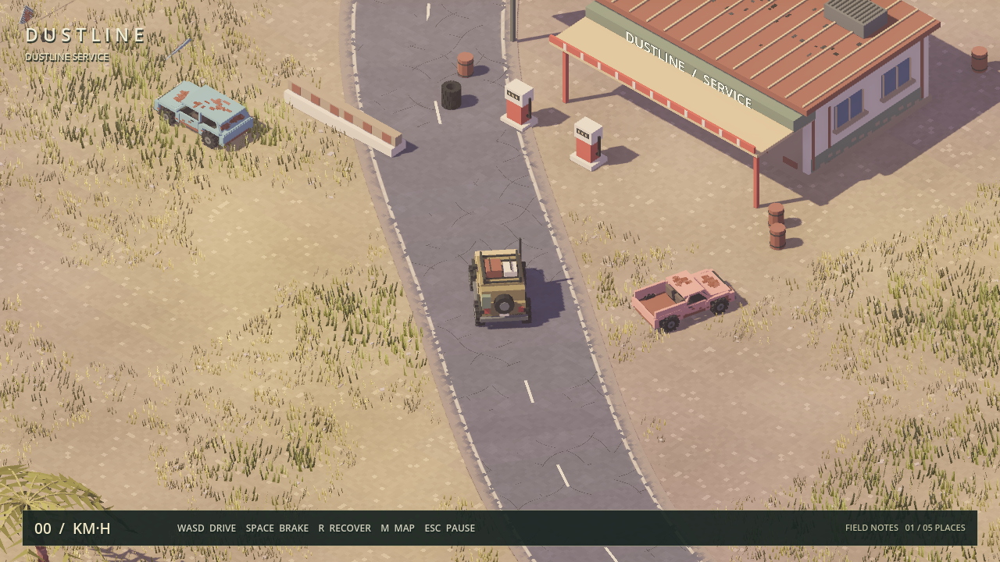

# Off Road Rider

参考 [noio 的《GARBAGE COUNTRY》预告](https://x.com/noio_games/status/1931808116879786225) 制作的原创 3D 越野探索项目。当前是可运行的开发版本，**尚未完成发布验收**。



当前版本 **0.4.0**：[版本说明](docs/RELEASE_0.4.0.md)。包含最新十车型驾驶舱、三地图、车型/地形声音，以及原创背景曲和独立音乐音量。

下一阶段先打磨现有车队和地图，再增加任务玩法：[车型打磨计划](docs/VEHICLE_POLISH_PLAN.md) · [地图场景打磨计划](docs/MAP_POLISH_PLAN.md)

## 运行

引擎：Godot 4.7.2。当前 Mac 安装于 `/Users/m4002/Applications/Godot.app`。在项目目录依次执行：

```sh
/Users/m4002/Applications/Godot.app/Contents/MacOS/Godot --headless --path . --editor --import --quit
/Users/m4002/Applications/Godot.app/Contents/MacOS/Godot --path .
```

也可用 Godot 打开 `project.godot`，等待导入完成后按 F6/F5 运行。默认使用 Metal / Forward+；兼容性诊断可传 `--rendering-method gl_compatibility`，该模式没有相同的环境遮蔽效果。

## 车队与多地图更新

[十车外观对照](docs/previews/fleet-all.jpg) · [十车驾驶舱](docs/previews/fleet-drivers.jpg) · [三张地图实景](docs/previews/maps-overview.jpg)

- **10 台可驾驶车辆**：保留 Scout、Ridge、Ranger、Atlas；新增牧马人、乌尼莫克 U5023、F-150、Hilux、东风 EQ246 和 Dodge WC-62 的外观参考车型。车身轮廓、灯组、格栅、驾驶室、货斗与载货结构分别设计，全部细化轮拱、轮胎、轮毂、车门和驾驶舱。
- **3 张独立地图**，每张 1,440 × 1,200 米。原地图从 900 × 780 米扩大到约 2.46 倍面积，保留中心废土、修理站、废车场、双桥和原有六类区域。
- **OLD FRONTIER**：森林、草原、山地、沙漠、泥地、沼泽，新增戈壁、城市废墟、山石攀爬路线及芦苇湖。
- **SALT COAST**：大海、沙滩、港口废墟、沙丘、戈壁、河流、湿地与绿洲湖。
- **ALPINE REACH**：雪山、松林、山口、攀岩区、高山草甸、冰湖和高山湖泊。
- `Esc → Choose expedition map` 或 `M → Explore another map` 切换地图。保留当前车型、驾驶视角；各地图的发现记录和目的地在本次运行中分别保存。录像结束并保存后才能切换地图。
- 地形按 64 米区块构建和剔除；岩石、树干、废墟和攀爬台阶都有碰撞。新增戈壁、积雪和冰面的抓地力、阻力与动力参数，雪地扬起浅色粉尘。
- 第一人称驾驶、五种镜头、低速挡、独立跟拍录像和游戏声音继续可用。

车型是参考实车外观的原创卡通模型，动力参数为游戏调校值，未声称机械复刻或官方授权。地图为原创扩展。驾驶仍采用带辅助稳定的射线悬挂，尚无轮胎变形、可变形泥地、损伤与绞盘。

## 操作

| 操作 | 按键 |
| --- | --- |
| 驾驶 | WASD / 方向键 |
| 手刹 | Space |
| 回到修理站 | R |
| 查看探索地图 | M |
| 暂停、地图选择、音量、退出 | Esc |
| 缩放俯视镜头 | 鼠标滚轮 |
| 切换驾驶视角 | C |
| 观察左右、上下 | 按住鼠标右键拖动，松开回正 |
| 高速挡 / 低速越野挡 | L |
| 车型选择（先停车） | V |
| 录像开始 / 停止 | F9 |
| 切换录像镜头 | F6；也可在 Esc 菜单选择 |
| 打开录像目录 | F10 |
| 隐藏 / 显示 HUD | H |
| 设置目的地 | M 打开地图后单击 |

## 当前内容

- 三张各 1,440 × 1,200 米的独立地图，包含 30 个发现地点。
- 31 个独立模型场景；六种破损废车、四类废料、车身、轮胎、设施和护栏都有可重建的源代码。
- 成片荒草、下垂棕榈叶、层状岩壁、可驾驶垃圾山、磨损路面和曲折浅滩；暖光、偏紫阴影与更近的跟随视角。
- 四轮或六轮射线悬挂、前进/倒车、抓地力和手刹、涉水阻力、尘土、水花、限量轮迹。
- 十车型各两层引擎声、十二种地形行驶声、风声、碰撞和发现提示，以及 96 秒原创背景曲，共 36 个当前使用的原创声音文件。
- 五种驾驶镜头、独立跟拍录像、地点发现、地图、暂停和总音量控制。探索记录当前只保留在本次运行中。

素材来源与编辑方式见 [素材清单](docs/ASSETS.md)；参考视频拆解、地图推定范围见 [参考说明](docs/REFERENCE.md)；发布差距和实测记录见 [验收记录](docs/ACCEPTANCE.md)。当前配乐为原创探索循环曲；视频中的塔防、升级系统尚未纳入本游戏。

本轮画面对照：[修改前后](docs/previews/comparison.png)、[废车场](docs/previews/yard.png)、[车辆近景](docs/previews/scout.png)、[浅滩行驶](docs/previews/river.png)。

## 录像

F9 开始，再按 F9 保存；F6 切换当前驾驶画面、追车、侧拍、航拍与每 8 秒自动切镜的导演模式。独立跟拍默认不包含 HUD；当前驾驶画面模式可用 H 隐藏 HUD。输出在 `~/Movies/Off Road Rider/`（F10 打开），是 H.264 + AAC 的 MP4，最高 1280×720、目标 30 FPS。实际帧率受硬件、视角与负载影响，使用真实时间戳，避免视频加速播放。

编码器只接收游戏画面和游戏混音，不录桌面或麦克风，不依赖 FFmpeg。录制期间切换录像镜头不会改变驾驶镜头；正常退出会等待保存完成。若进程崩溃或编码失败，未完成文件可能保留为 `.partial.mp4`，不代表成功录像。当前不支持自动保存“过去 30 秒”的回放。

## 验证与构建

下面的 `godot` 指对应平台的 Godot 可执行文件。导入完成后再运行测试，不能同时启动两者。

```sh
godot --headless --path . --editor --import --quit
godot --headless --path . --script tests/smoke.gd
godot --headless --path . --script tests/expedition.gd
godot --headless --path . --script tests/maps.gd
godot --headless --path . --script tests/audio.gd
godot --path . --script tests/capture.gd -- /tmp/off-road-rider-service.png
```

冒烟测试验证接地、静止稳定、加速、转向、制动、重置、空中动力限制、涉水、暂停、双桥通行和垃圾山碰撞，并检查场景实例的空间分区。去掉 `--headless` 运行同一测试，还会验证渲染器中的实例变换与颜色（Godot 无界面渲染器不保存这两项）。检查输出中的 `SMOKE: PASS`，也要检查 `SCRIPT ERROR` / `ERROR`，不能只看退出码。

驾驶声音使用十车独立引擎和十二种地形循环，参考版本与合成方式见 [音效设计](docs/DRIVING_AUDIO.md)。`tests/audio.gd` 检查声音状态及生命周期；`godot --path . --script tests/capture_driving_audio.gd` 会实际开车并把十车混音 WAV 写到 `build/audio-review/`，需要可用音频输出，不录视频或麦克风。

```sh
sh tools/build_recorder.sh  # macOS + Xcode Command Line Tools
mkdir -p build
godot --headless --path . --export-pack macOS build/OffRoadRider.pck
godot --main-pack build/OffRoadRider.pck
```

`build/OffRoadRider.pck` 是本机测试用资源包，需 Godot 运行。

### macOS DMG

在 macOS 上安装与引擎版本一致的官方导出模板（Godot 的 **Editor → Manage Export Templates**），然后在项目目录执行：

```sh
sh tools/build_recorder.sh
mkdir -p build
godot --headless --path . --editor --import --quit
godot --headless --path . --export-release macOS build/OffRoadRider-0.4.0.dmg
hdiutil verify build/OffRoadRider-0.4.0.dmg
```

打开 `build/OffRoadRider-0.4.0.dmg`，把其中的 `Off Road Rider.app` 拖到“应用程序”后启动；玩家无需安装 Godot。默认导出包含 Apple Silicon 和 Intel 两种架构，仍需在各目标机型验证图形兼容性。

当前导出使用临时签名（ad-hoc），没有 Apple Developer ID 签名或公证；通过网络下载后，macOS 可能拦截首次启动。正式分发前需要配置开发者证书并完成公证，详见 [Godot macOS 导出说明](https://docs.godotengine.org/en/4.7/tutorials/export/exporting_for_macos.html)。安装包仍属于开发测试版本，不表示已完成游戏发布验收。`build/` 中的产物不提交到 Git。

## 编辑素材

```sh
godot --headless --path . --script tools/build_assets.gd
python3 tools/build_audio.py
godot --headless --path . --editor --import --quit
```

模型源文件是 `tools/build_assets.gd`，声音源文件是 `tools/build_audio.py`。地图地标和主路布局在 `assets/world/route.json`，地形、植被、桥梁和废料分布在 `world.gd`。旧的 `audio/` 是历史原型音频，当前游戏不再引用，导出时排除。

### 新功能回归检查

```sh
godot --path . --script tests/capture_features.gd
godot --path . --script tests/recording.gd
python3 tests/check_recording.py "/path/from/RECORDING_FILE.mp4"
```

`capture_features.gd` 生成各区域、驾驶舱、车型和菜单的实机图；`recording.gd` 在真实时间下驾驶到 80 km/h 以上，切换独立镜头并验证停止、再次录制和退出保存。最后一个媒体检查需要开发机上的 FFmpeg，仅用于验证文件。

`vehicles.gd` 是车型与地表驾驶参数；`maps.gd` 定义三张地图，`regions.gd` 是区域、小径和植被的可编辑源；`driving_camera.gd` 管理驾驶与跟拍视角。`native/recorder.swift` 使用系统 AVFoundation 编码，`tools/build_recorder.sh` 编译 universal helper，导出插件将其自动装入 PCK。构建需先编译 helper，玩家不需要开发工具。

驾驶舱细化后的车型包含圆角内饰、座椅缝线、精细方向盘、实时速度表和罗盘。按 `C` 切换到第一人称，按住鼠标右键查看仪表及副驾。仅重建车辆、检查仪表与生成第一人称实机截图：

```sh
godot --headless --path . --script tools/build_assets.gd -- --vehicles-only
godot --headless --path . --editor --import
godot --headless --path . --fixed-fps 60 --script tests/cockpit.gd
godot --path . --resolution 1600x900 --script tests/cockpit.gd -- --capture
```

截图写入 `build/cockpit-*.png`；包含默认驾驶视角、隐藏 HUD 的同机位画面，以及驾驶位向右查看内饰的画面。

车队和地图截图检查：

```sh
godot --path . --resolution 1600x900 --script tests/capture_fleet.gd
godot --path . --resolution 1600x900 --script tests/capture_maps.gd
```

图片输出到 `build/fleet-*.png` 和 `build/map-*.png`。车辆与地图全景截图使用游戏内实际模型和光照，人工指定相机机位方便对照；驾驶舱截图使用正常第一人称视角。车辆参考来源见 [车队与地图设计说明](docs/FLEET_AND_MAPS.md)。
